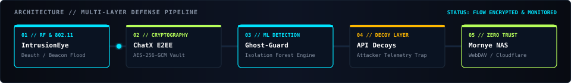
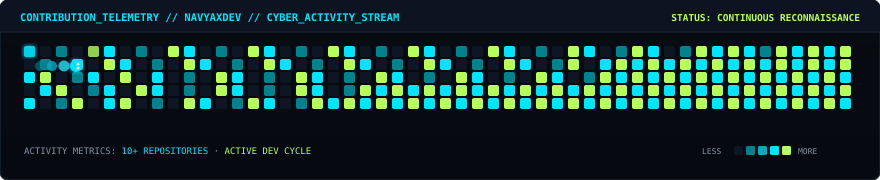

<div align="center">

  <!-- ==================== HERO COMMAND CONSOLE ==================== -->
  <a href="https://portfolio.navya.dpdns.org/">
    
  </a>

  <br/><br/>

  <!-- PRIMARY PORTFOLIO CALL-TO-ACTION -->
  <p align="center">
    <a href="https://portfolio.navya.dpdns.org/">
      
    </a>
  </p>

  <p align="center">
    <b>[Explore My Portfolio](https://portfolio.navya.dpdns.org/)</b>
  </p>

  <br/>

  <!-- ==================== TERMINAL INITIALIZATION SEQUENCE ==================== -->
  

  <br/>

  <!-- ==================== ARCHITECTURAL DEFENSE PIPELINE ==================== -->
  

</div>

<br/>

<!-- ==================== ABOUT & WHOAMI SECTION ==================== -->
## 📡 `> WHOAMI`

```bash
$ cat << 'EOF' > /proc/sys/identity.info
[OPERATOR]       Dinesh Patra (@navyaXdev)
[ROLES]          Developer · Cybersecurity Enthusiast · Technology Builder
[PORTFOLIO]      https://portfolio.navya.dpdns.org/
[ACADEMIC]      First-Year B.Sc. Student in Computer Science & Systems Fundamentals
[CORE FOCUS]     Software Engineering • Linux Systems • Network Security • Applied Cryptography
[STATUS]         Available for technical roles, internships & security research collaborations
[PHILOSOPHY]     "Building practical digital solutions. Understanding how systems work from the packet up."
EOF
```

I am a software developer and cybersecurity enthusiast focused on systems-level architecture, defensive security, and applied cryptography. Rather than treating security as an afterthought or relying on black-box tools, I build practical digital systems from first principles — understanding every abstraction layer from the network frame to client-side cryptosystems.

Explore my wider professional identity, interactive architecture case studies, and engineering philosophy on my personal website:
👉 **[Explore My Portfolio](https://portfolio.navya.dpdns.org/)**

* **Wireless Intrusion Diagnostics:** Capturing 802.11 frames in promiscuous mode with microcontrollers to monitor and isolate deauthentication frames and beacon floods in real time.
* **Applied Cryptography & E2EE:** Designing zero-knowledge browser architectures using AES-256-GCM, PBKDF2, and Argon2id so servers never hold unencrypted payload data.
* **Machine Learning for Security:** Training unsupervised Isolation Forest models on benign API telemetry to identify anomalous patterns without brittle signature databases.
* **Hardened Infrastructure:** Architecting resilient Linux servers (Debian, Kali), containerized microservices via Docker, and encrypted perimeter tunnels with Cloudflare Zero-Trust.

---

<!-- ==================== RADAR & TELEMETRY DISPLAY ==================== -->
<div align="center">
  
</div>

<br/>

<!-- ==================== DEFENSIVE DOMAINS & RESEARCH ==================== -->
## 🛡️ `> DEFENSIVE DOMAINS & RESEARCH`

<table width="100%">
  <tr>
    <td width="50%" valign="top">
      <h4>🛰️ 01. Wireless &amp; Network Defense</h4>
      <p>Researching 802.11 frame structures, RF promiscuous monitoring, TCP/IP flow diagnostics, and lightweight embedded intrusion detection systems on low-power hardware.</p>
      <code>ESP32</code> • <code>802.11 Promiscuous</code> • <code>Packet Analysis</code> • <code>Wireshark</code>
    </td>
    <td width="50%" valign="top">
      <h4>🔐 02. Applied Cryptography &amp; E2EE</h4>
      <p>Architecting client-side cryptographic vaults using WebCrypto API primitives, symmetric AES-256-GCM encryption, Argon2id key derivation, and zero-knowledge data pipelines.</p>
      <code>AES-256-GCM</code> • <code>Argon2id</code> • <code>WebCrypto</code> • <code>Zero-Knowledge</code>
    </td>
  </tr>
  <tr>
    <td width="50%" valign="top">
      <h4>🧠 03. Behavioral Threat Defense &amp; ML</h4>
      <p>Deploying unsupervised machine learning algorithms (Isolation Forest) on baseline traffic to detect zero-day API abuse, silently routing anomalous actors to decoy honeypots.</p>
      <code>Isolation Forest</code> • <code>API Defenses</code> • <code>Honeypots</code> • <code>Heuristics</code>
    </td>
    <td width="50%" valign="top">
      <h4>🐧 04. Linux Systems &amp; Hardening</h4>
      <p>Administering Linux distributions (Debian, Kali), filesystem permission matrices, systemd service daemons, Docker Compose stacks, and Cloudflare Zero-Trust perimeter tunnels.</p>
      <code>Kali Linux</code> • <code>Docker</code> • <code>Cloudflare Tunnels</code> • <code>RFC 4918 WebDAV</code>
    </td>
  </tr>
</table>

---

<!-- ==================== TECHNICAL ARSENAL ==================== -->
## ⚡ `> TECHNICAL ARSENAL`

```
┌──[navyaXdev@arsenal]─[~/technologies]
└──$ ls -la --group-directories-first
```

### Core Languages
<p align="left">
  
  
  
  
  
  
</p>

### Systems &amp; Security Engineering
<p align="left">
  
  
  
  
  
  
</p>

### Frameworks &amp; Tooling
<p align="left">
  
  
  
  
  
  
</p>

---

<!-- ==================== FEATURED OPERATIONS & PROJECTS ==================== -->
## 📂 `> FEATURED OPERATIONS // REPOSITORIES`

<table width="100%">
  <!-- ROW 1 -->
  <tr>
    <td width="50%" valign="top">
      <div align="right">
        <code>[STATUS: VERIFIED // ACTIVE]</code>
      </div>
      <h3><a href="https://github.com/navyaXdev/IntrusionEye">📡 IntrusionEye</a></h3>
      <p><b>Real-Time ESP32 Wi-Fi Intrusion Detection System</b></p>
      <p>Promiscuous 802.11 monitor that detects Deauthentication attacks, Beacon Floods, Probe Floods, and SYN Floods. Serves a real-time web dashboard directly from microcontroller memory.</p>
      <p><b>Stack:</b> <code>C++</code> • <code>ESP32</code> • <code>802.11 Promiscuous</code> • <code>WebSockets</code> • <code>Embedded HTTP</code></p>
      <p>
        <a href="https://github.com/navyaXdev/IntrusionEye"><b>🔗 View Repository</b></a>
      </p>
    </td>
    <td width="50%" valign="top">
      <div align="right">
        <code>[STATUS: VERIFIED // DEPLOYED]</code>
      </div>
      <h3><a href="https://github.com/navyaXdev/Ghost-Guard">🛡️ Ghost-Guard</a></h3>
      <p><b>Behavior-Based API Defense &amp; Decoy Honeypot Layer</b></p>
      <p>Detects unknown API threats without predefined signature rules. Trains an Isolation Forest on benign baseline traffic, then silently diverts anomalous requests into a decoy honeypot layer while logging attacker behavioral telemetry.</p>
      <p><b>Stack:</b> <code>JavaScript</code> • <code>Machine Learning</code> • <code>Isolation Forest</code> • <code>API Security</code> • <code>Vercel</code></p>
      <p>
        <a href="https://github.com/navyaXdev/Ghost-Guard"><b>🔗 View Repository</b></a> • <a href="https://ghost-guard-beryl.vercel.app"><b>🌐 Live Application</b></a>
      </p>
    </td>
  </tr>

  <!-- ROW 2 -->
  <tr>
    <td width="50%" valign="top">
      <div align="right">
        <code>[STATUS: VERIFIED // EXTENSION]</code>
      </div>
      <h3><a href="https://github.com/navyaXdev/Safora">🔍 Safora</a></h3>
      <p><b>Real-Time Phishing URL Detection Engine</b></p>
      <p>Chrome extension combining a trained machine-learning risk classifier with an independent rule-based heuristic explanation engine. Delivers plain-English security reasoning to users in real time.</p>
      <p><b>Stack:</b> <code>JavaScript</code> • <code>ML Risk Classifier</code> • <code>Chrome Extension Manifest V3</code> • <code>Heuristics</code></p>
      <p>
        <a href="https://github.com/navyaXdev/Safora"><b>🔗 View Repository</b></a> • <a href="https://safora-one.vercel.app"><b>🌐 Live Application</b></a>
      </p>
    </td>
    <td width="50%" valign="top">
      <div align="right">
        <code>[STATUS: NYC CODEQUEST 2026]</code>
      </div>
      <h3><a href="https://github.com/navyaXdev/ChatX">🔐 ChatX</a></h3>
      <p><b>Client-Side End-to-End Encrypted Web Messenger</b></p>
      <p>Zero-knowledge web chat architecture built for NYC CodeQuest 2026 (CYBER-02). Messages are encrypted inside the browser with AES-256-GCM before the backend server ever receives them.</p>
      <p><b>Stack:</b> <code>React</code> • <code>Flask</code> • <code>AES-256-GCM</code> • <code>WebCrypto API</code> • <code>PBKDF2</code> • <code>Vercel</code></p>
      <p>
        <a href="https://github.com/navyaXdev/ChatX"><b>🔗 View Repository</b></a> • <a href="https://chat-x-ruddy.vercel.app"><b>🌐 Live Application</b></a>
      </p>
    </td>
  </tr>

  <!-- ROW 3 -->
  <tr>
    <td width="50%" valign="top">
      <div align="right">
        <code>[STATUS: VERIFIED // ACTIVE]</code>
      </div>
      <h3><a href="https://github.com/navyaXdev/Mornye-Network-Storage">📦 Mornye-Network-Storage</a></h3>
      <p><b>Self-Hosted Linux Storage &amp; Zero-Trust WebDAV Server</b></p>
      <p>Open-source private cloud network storage conforming to RFC 4918 WebDAV. Engineered for Debian and Kali Linux environments with Docker Compose, Argon2id authentication, and encrypted Cloudflare Zero-Trust tunnels.</p>
      <p><b>Stack:</b> <code>Linux Shell</code> • <code>Docker</code> • <code>Cloudflare Tunnel</code> • <code>Argon2id</code> • <code>WebDAV</code></p>
      <p>
        <a href="https://github.com/navyaXdev/Mornye-Network-Storage"><b>🔗 View Repository</b></a> • <a href="https://navyaxdev.github.io/Mornye-Network-Storage/"><b>📖 Documentation</b></a>
      </p>
    </td>
    <td width="50%" valign="top">
      <div align="right">
        <code>[STATUS: HARDWARE RESEARCH]</code>
      </div>
      <h3><a href="https://github.com/navyaXdev/ESP8266-DUCKY">💻 ESP8266-DUCKY</a></h3>
      <p><b>Hardware Keystroke Injection &amp; Wireless Payloads</b></p>
      <p>Microcontroller-based HID emulation and wireless delivery mechanisms on ESP8266 hardware, investigating physical attack vectors and embedded firmware security.</p>
      <p><b>Stack:</b> <code>C++</code> • <code>ESP8266</code> • <code>Hardware Security</code> • <code>HID Emulation</code></p>
      <p>
        <a href="https://github.com/navyaXdev/ESP8266-DUCKY"><b>🔗 View Repository</b></a>
      </p>
    </td>
  </tr>
</table>

---

<!-- ==================== VERIFIED ACHIEVEMENTS ==================== -->
## 🏆 `> VERIFIED ACHIEVEMENTS & HACKATHONS`

<table width="100%">
  <tr>
    <td width="50%" valign="top">
      <h4>🎖️ NYC CodeQuest 2026 — Round 3 Qualifier</h4>
      <p><b>Status:</b> <code>VERIFIED CREDENTIAL // CERT-2026-MFDX9C</code></p>
      <p>Qualified through competitive screening rounds into Round 3 of NYC CodeQuest, building secure cryptographic software architectures under competitive time constraints.</p>
    </td>
    <td width="50%" valign="top">
      <h4>🇮🇳 Smart India Hackathon (SIH)</h4>
      <p><b>Status:</b> <code>NATIONAL PARTICIPANT // RESULT AWAITED</code></p>
      <p>Participated in the premier nationwide innovation hackathon organized by the Ministry of Education's Innovation Cell &amp; AICTE, designing practical technological solutions for nationwide challenges.</p>
    </td>
  </tr>
</table>

---

<!-- ==================== GITHUB TELEMETRY & SNAKE ==================== -->
## 📊 `> GITHUB TELEMETRY & ACTIVITY STREAM`

<div align="center">

  <!-- Contribution Snake Animation (Dynamic / Fallback Compatible) -->
  <picture>
    <source media="(prefers-color-scheme: dark)" srcset="https://raw.githubusercontent.com/navyaXdev/navyaXdev/output/github-contribution-grid-snake-dark.svg">
    <source media="(prefers-color-scheme: light)" srcset="https://raw.githubusercontent.com/navyaXdev/navyaXdev/output/github-contribution-grid-snake.svg">
    
  </picture>

  <br/><br/>

  <!-- GitHub Statistics Telemetry Cards -->
  <table width="100%">
    <tr>
      <td width="50%" align="center">
        
      </td>
      <td width="50%" align="center">
        
      </td>
    </tr>
  </table>

</div>

---

<!-- ==================== CONNECT SECTION ==================== -->
## 📡 `> ESTABLISH CONNECTION`

```bash
$ ping -c 1 portfolio.navya.dpdns.org
PING portfolio.navya.dpdns.org (104.21.75.142): 56 data bytes
64 bytes from 104.21.75.142: icmp_seq=0 ttl=64 time=0.038 ms
--- portfolio.navya.dpdns.org ping statistics ---
1 packets transmitted, 1 packets received, 0.0% packet loss
```

My official portfolio website is the primary destination for exploring my complete technical portfolio, credentials, and full interactive architecture demonstrations:

<p align="left">
  <a href="https://portfolio.navya.dpdns.org/">
    
  </a>
  <a href="mailto:dinesh.cyber25@gmail.com">
    
  </a>
  <a href="https://www.linkedin.com/in/dinesh-patra-56a505413">
    
  </a>
  <a href="https://github.com/navyaXdev">
    
  </a>
</p>

🔗 **Primary Portfolio Destination:** **[Explore My Portfolio](https://portfolio.navya.dpdns.org/)**

---

<!-- ==================== FOOTER ==================== -->
<div align="center">
  <a href="https://portfolio.navya.dpdns.org/">
    
  </a>
  <br/>
  <p align="center">
    <b>[Explore My Portfolio](https://portfolio.navya.dpdns.org/)</b>
  </p>
</div>
