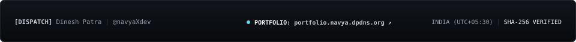

  <!-- ==================== 1. PREMIUM ANIMATED HERO ==================== -->
  

    

  <!-- COMPACT TERMINAL INITIALIZATION -->
  

 

<!-- ==================== 2. SHORT ABOUT ME ==================== -->
## `> WHOAMI`

I am a software developer and cybersecurity enthusiast focused on low-level systems, wireless defense, and applied cryptography. Currently in my first year of B.Sc. studies in Computer Science, I engineer practical security architectures from the packet up — from microcontroller RF monitoring to client-side cryptosystems.

Explore my interactive demonstrations, case studies, and full professional identity:  
👉 **[Explore My Portfolio](https://portfolio.navya.dpdns.org/)**

---

<!-- ==================== 3. SELECTED TECHNICAL SKILLS ==================== -->
## `> TECHNICAL ARSENAL`

  

---

<!-- ==================== 4. TOP 3 FEATURED PROJECTS ==================== -->
## `> FEATURED OPERATIONS`

  

 

<table width="100%">
  <tr>
    <td width="33.3%" valign="top">
      
<code>[HARDWARE IDS]</code>

      <h3><a href="https://github.com/navyaXdev/IntrusionEye">📡 IntrusionEye</a></h3>
      
<b>Real-Time ESP32 Wi-Fi IDS</b>

      
Captures 802.11 wireless frames in promiscuous mode to detect Deauthentication attacks, Beacon Floods, and Probe Floods with a live embedded web dashboard.

      
<b>Stack:</b> <code>C++</code> • <code>ESP32</code> • <code>802.11 Promiscuous</code> • <code>WebSockets</code>

      
🔗 <a href="https://github.com/navyaXdev/IntrusionEye"><b>View Repository</b></a>

    </td>
    <td width="33.3%" valign="top">
      
<code>[ML DEFENSE]</code>

      <h3><a href="https://github.com/navyaXdev/Ghost-Guard">🛡️ Ghost-Guard</a></h3>
      
<b>Behavior-Based API Honeypot</b>

      
Detects unknown API threats without signatures. Trains an Isolation Forest on benign traffic, then silently diverts anomalous requests into a decoy honeypot layer.

      
<b>Stack:</b> <code>JavaScript</code> • <code>Machine Learning</code> • <code>Isolation Forest</code> • <code>API Security</code>

      
🔗 <a href="https://github.com/navyaXdev/Ghost-Guard"><b>View Repository</b></a> • <a href="https://ghost-guard-beryl.vercel.app"><b>Live App</b></a>

    </td>
    <td width="33.3%" valign="top">
      
<code>[CRYPTOGRAPHY]</code>

      <h3><a href="https://github.com/navyaXdev/ChatX">🔐 ChatX</a></h3>
      
<b>Client-Side E2EE Web Messenger</b>

      
Zero-knowledge web chat built for NYC CodeQuest 2026. Messages are encrypted inside the browser with AES-256-GCM before reaching the server.

      
<b>Stack:</b> <code>React</code> • <code>Flask</code> • <code>AES-256-GCM</code> • <code>WebCrypto API</code> • <code>Argon2id</code>

      
🔗 <a href="https://github.com/navyaXdev/ChatX"><b>View Repository</b></a> • <a href="https://chat-x-ruddy.vercel.app"><b>Live App</b></a>

    </td>
  </tr>
</table>

---

<!-- ==================== 5. GITHUB ACTIVITY ==================== -->
## `> ACTIVITY TELEMETRY`

  <!-- Contribution Snake Animation -->
  <picture>
    <source media="(prefers-color-scheme: dark)" srcset="https://raw.githubusercontent.com/navyaXdev/navyaXdev/output/github-contribution-grid-snake-dark.svg">
    <source media="(prefers-color-scheme: light)" srcset="https://raw.githubusercontent.com/navyaXdev/navyaXdev/output/github-contribution-grid-snake.svg">
    
  </picture>

    

  <!-- Compact GitHub Telemetry Cards -->
  <table width="100%">
    <tr>
      <td width="50%" align="center">
        
      </td>
      <td width="50%" align="center">
        
      </td>
    </tr>
  </table>

---

<!-- ==================== 6. CONNECT & PORTFOLIO ==================== -->
## `> CONNECT`

Primary destination for complete credentials, case studies, and technical architecture:  
🌐 **[Explore My Portfolio](https://portfolio.navya.dpdns.org/)**

  
  
  
  

 

  

