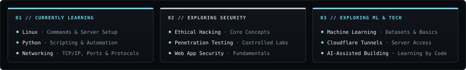

  <!-- ==================== 1. PREMIUM ANIMATED HERO ==================== -->
  

    

  <!-- COMPACT TERMINAL INITIALIZATION -->
  

 

<!-- ==================== 2. SHORT INTRODUCTION ==================== -->
## `> WHOAMI`

I'm a Computer Science student who enjoys exploring how technology works, learning new concepts, and turning ideas into practical projects.

Currently, I'm building my foundations in Linux, Python, and Networking while exploring Ethical Hacking, Penetration Testing, and Machine Learning.

I enjoy experimenting with ideas, solving practical problems, and learning through building projects. I also frequently use AI-assisted development tools (such as Google Antigravity) to experiment, understand code, and bring my ideas to life.

Explore my interactive projects, background, and personal portfolio:  
👉 **[Explore My Portfolio](https://portfolio.navya.dpdns.org/)**

---

<!-- ==================== 3. CURRENTLY LEARNING ==================== -->
## `> CURRENTLY LEARNING`

  

 

* **Linux Fundamentals:** Exploring how Linux systems work, basic command-line navigation, shell scripting basics, and setting up Linux servers.
* **Python Fundamentals:** Learning programming concepts, writing basic automation scripts, and experimenting with small practical tools.
* **Networking Fundamentals:** Studying the fundamentals of TCP/IP, understanding IP addressing, ports, protocols, and how data traverses networks.
* **Exploring Cybersecurity:** Developing foundational knowledge in Ethical Hacking, Web Application Security, and practical penetration testing techniques in controlled environments.
* **Exploring Machine Learning:** Understanding basic machine learning algorithms, working with datasets, and experimenting with small ML-assisted projects.

---

<!-- ==================== 4. AREAS OF INTEREST ==================== -->
## `> AREAS OF INTEREST`

<table width="100%">
  <tr>
    <td width="50%" valign="top">
      <h4>🎯 01. Ethical Hacking &amp; Penetration Testing</h4>
      
Interested in understanding security vulnerabilities, learning reconnaissance and assessment techniques, and exploring defensive strategies in safe, legal lab environments.

    </td>
    <td width="50%" valign="top">
      <h4>🧠 02. Machine Learning</h4>
      
Curious about how machine learning can be applied to practical problems, analyzing datasets, and experimenting with anomaly detection models.

    </td>
  </tr>
  <tr>
    <td width="50%" valign="top">
      <h4>🐧 03. Linux &amp; Networking</h4>
      
Building strong daily fluency with Linux environments, server administration basics, command chaining, and network protocol diagnostics.

    </td>
    <td width="50%" valign="top">
      <h4>⚡ 04. Practical Project Building</h4>
      
Turning real-life problems into functional software and hardware experiments, learning by writing, debugging, and improving code with AI assistance.

    </td>
  </tr>
</table>

---

<!-- ==================== 5. THREE SELECTED PERSONAL PROJECTS ==================== -->
## `> SELECTED PROJECTS`

<table width="100%">
  <tr>
    <td width="33.3%" valign="top">
      
<code>[SERVER &amp; STORAGE]</code>

      <h3><a href="https://github.com/navyaXdev/Mornye-Network-Storage">📦 Mornye Network Storage</a></h3>
      
<b>Self-Hosted Linux Storage &amp; Cloudflare Tunnel</b>

      
A hands-on personal project setting up a private Linux-based storage system. Focused on server configuration, shell commands, and integrating Cloudflare Tunnels for secure remote access without port forwarding.

      
<b>Focus:</b> <code>Linux Server</code> • <code>Shell</code> • <code>Cloudflare Tunnel</code> • <code>Docker</code>

      
🔗 <a href="https://github.com/navyaXdev/Mornye-Network-Storage"><b>View Repository</b></a> • <a href="https://navyaxdev.github.io/Mornye-Network-Storage/"><b>Docs</b></a>

    </td>
    <td width="33.3%" valign="top">
      
<code>[HARDWARE EXPERIMENT]</code>

      <h3><a href="https://github.com/navyaXdev/IntrusionEye">📡 IntrusionEye</a></h3>
      
<b>ESP32 Wi-Fi Traffic Monitoring Experiment</b>

      
An embedded hardware project using an ESP32 microcontroller to explore 802.11 wireless frames in promiscuous mode, experimenting with detecting Deauthentication frames and flood attacks with a basic web UI.

      
<b>Focus:</b> <code>C++</code> • <code>ESP32</code> • <code>802.11 Promiscuous</code> • <code>WebSockets</code>

      
🔗 <a href="https://github.com/navyaXdev/IntrusionEye"><b>View Repository</b></a>

    </td>
    <td width="33.3%" valign="top">
      
<code>[ML EXPERIMENT]</code>

      <h3><a href="https://github.com/navyaXdev/Ghost-Guard">🛡️ Ghost-Guard</a></h3>
      
<b>Exploring ML-Based API Anomaly Detection</b>

      
An experimental project exploring unsupervised machine learning (Isolation Forest) to detect unusual API request patterns by learning benign traffic baselines and diverting anomalous calls to simulated decoy endpoints.

      
<b>Focus:</b> <code>JavaScript</code> • <code>Machine Learning</code> • <code>Isolation Forest</code> • <code>API Defense</code>

      
🔗 <a href="https://github.com/navyaXdev/Ghost-Guard"><b>View Repository</b></a> • <a href="https://ghost-guard-beryl.vercel.app"><b>Live Demo</b></a>

    </td>
  </tr>
</table>

---

<!-- ==================== 6. GITHUB ACTIVITY ==================== -->
## `> ACTIVITY TELEMETRY`

  <!-- Contribution Snake Animation -->
  <picture>
    <source media="(prefers-color-scheme: dark)" srcset="https://raw.githubusercontent.com/navyaXdev/navyaXdev/output/github-contribution-grid-snake-dark.svg">
    <source media="(prefers-color-scheme: light)" srcset="https://raw.githubusercontent.com/navyaXdev/navyaXdev/output/github-contribution-grid-snake.svg">
    
  </picture>

    

  <!-- GitHub Statistics Telemetry Cards -->
  <table width="100%">
    <tr>
      <td width="50%" align="center">
        
      </td>
      <td width="50%" align="center">
        
      </td>
    </tr>
  </table>

---

<!-- ==================== 7. PORTFOLIO & SOCIAL LINKS ==================== -->
## `> CONNECT`

Personal website and complete portfolio destination:  
🌐 **[Explore My Portfolio](https://portfolio.navya.dpdns.org/)**

  
  
  
  

 

  

