<div align="center">

  <!-- ==================== HERO OPERATIONS CONSOLE ==================== -->
  <a href="https://github.com/navyaXdev">
    
  </a>

  <br/>

  <!-- ==================== TERMINAL BOOT SEQUENCE ==================== -->
  

  <br/>

  <!-- ==================== MULTI-LAYER DEFENSE PIPELINE ==================== -->
  

</div>

<br/>

<!-- ==================== WHOAMI SECTION ==================== -->
## 📡 `> WHOAMI`

```bash
$ cat << 'EOF' > /proc/sys/identity.info
[OPERATOR]       Dinesh Patra (@navyaXdev)
[ROLE]           Cybersecurity Enthusiast & Systems Builder
[FOCUS]          Hardware RF Monitoring • Applied Cryptography • Behavioral API Defense • Linux Engineering
[ACADEMIC]      First-Year B.Sc. Student in Computer Science & Systems Fundamentals
[STATUS]         Available for technical roles, internships, and security research collaborations
[PHILOSOPHY]     "Building practical digital solutions. Understanding how systems work from the packet up."
EOF
```

I am a cybersecurity enthusiast and systems-focused developer driven by low-level curiosity and defensive engineering. Rather than relying solely on theoretical models or pre-packaged tools, I build practical security applications from first principles:

* **Hardware RF & Wireless Intrusion Detection:** Capturing 802.11 frames in promiscuous mode with microcontrollers to identify deauth frames and network floods in real time.
* **Applied Cryptography:** Engineering client-side zero-knowledge systems with AES-256-GCM, PBKDF2, and Argon2id so servers never hold unencrypted plaintext.
* **Machine Learning for Threat Detection:** Building unsupervised anomaly detection models (Isolation Forests) that flag zero-day API abuse without needing signature databases.
* **Linux Infrastructure & Zero-Trust:** Configuring hardened Linux server environments, Docker containers, and Cloudflare perimeter tunnels for secure remote storage.

---

<!-- ==================== RADAR & TELEMETRY DISPLAY ==================== -->
<div align="center">
  
</div>

<br/>

<!-- ==================== AREAS OF INTEREST ==================== -->
## 🛡️ `> DEFENSIVE DOMAINS & RESEARCH AREAS`

<table width="100%">
  <tr>
    <td width="50%" valign="top">
      <h4>🛰️ 01. Wireless &amp; Network Defense</h4>
      <p>Investigating 802.11 frame structures, RF promiscuous monitoring, TCP/IP flow diagnostics, beacon/probe flood mitigation, and lightweight embedded intrusion detection architectures.</p>
      <code>ESP32</code> • <code>802.11 Promiscuous</code> • <code>Wireshark</code> • <code>Packet Analysis</code>
    </td>
    <td width="50%" valign="top">
      <h4>🔐 02. Applied Cryptography &amp; E2EE</h4>
      <p>Designing client-side cryptographic vaults using the WebCrypto API, symmetric AES-256-GCM encryption, Argon2id key derivation, and end-to-end encrypted messaging systems.</p>
      <code>AES-256-GCM</code> • <code>Argon2id</code> • <code>WebCrypto</code> • <code>PBKDF2</code>
    </td>
  </tr>
  <tr>
    <td width="50%" valign="top">
      <h4>🧠 03. Behavioral Threat Defense &amp; ML</h4>
      <p>Deploying unsupervised machine learning algorithms (Isolation Forest) on benign telemetry to isolate abnormal API requests and routing malicious traffic into decoy honeypot layers.</p>
      <code>Isolation Forest</code> • <code>API Defenses</code> • <code>Honeypots</code> • <code>Phishing Detection</code>
    </td>
    <td width="50%" valign="top">
      <h4>🐧 04. Linux Systems &amp; Hardening</h4>
      <p>Administering Linux kernels (Debian, Kali), filesystem permissions, systemd service daemons, Docker microservices, WebDAV protocols, and Zero-Trust network tunnels.</p>
      <code>Kali Linux</code> • <code>Docker</code> • <code>Cloudflare Tunnels</code> • <code>RFC 4918 WebDAV</code>
    </td>
  </tr>
</table>

---

<!-- ==================== TECHNICAL ARSENAL ==================== -->
## ⚡ `> TECHNICAL ARSENAL`

```
┌──[navyaXdev@arsenal]─[~/technologies]
└──$ ls -la --group-directories-first
```

### 💻 Core Programming Languages
<p align="left">
  
  
  
  
  
  
</p>

### 🛡️ Systems, Security &amp; Infrastructure
<p align="left">
  
  
  
  
  
  
</p>

### 🔧 Frameworks &amp; Tooling
<p align="left">
  
  
  
  
  
  
</p>

---

<!-- ==================== FEATURED OPERATIONS / PROJECTS ==================== -->
## 📂 `> FEATURED OPERATIONS // REPOSITORIES`

<table width="100%">
  <!-- ROW 1 -->
  <tr>
    <td width="50%" valign="top">
      <div align="right">
        <code>[STATUS: VERIFIED // ACTIVE]</code>
      </div>
      <h3><a href="https://github.com/navyaXdev/IntrusionEye">📡 IntrusionEye</a></h3>
      <p><b>Real-Time ESP32 Wi-Fi Intrusion Detection System</b></p>
      <p>Monitors 802.11 wireless frames in promiscuous mode to detect Deauthentication attacks, Beacon Floods, Probe Floods, and SYN Floods. Features a real-time web UI served directly from the microcontroller.</p>
      <p><b>Stack:</b> <code>C++</code> • <code>ESP32</code> • <code>802.11 Promiscuous</code> • <code>WebSockets</code> • <code>Embedded HTTP Server</code></p>
      <p>
        <a href="https://github.com/navyaXdev/IntrusionEye"><b>🔗 View Repository</b></a>
      </p>
    </td>
    <td width="50%" valign="top">
      <div align="right">
        <code>[STATUS: VERIFIED // DEPLOYED]</code>
      </div>
      <h3><a href="https://github.com/navyaXdev/Ghost-Guard">🛡️ Ghost-Guard</a></h3>
      <p><b>Behavior-Based API Defense &amp; Decoy Honeypot Layer</b></p>
      <p>Detects unknown API attacks without predefined signature rules. Trains an Isolation Forest on benign baseline traffic, then silently diverts anomalous requests into a decoy honeypot layer while logging attacker behavioral telemetry.</p>
      <p><b>Stack:</b> <code>JavaScript</code> • <code>Machine Learning</code> • <code>Isolation Forest</code> • <code>API Security</code> • <code>Vercel</code></p>
      <p>
        <a href="https://github.com/navyaXdev/Ghost-Guard"><b>🔗 View Repository</b></a> • <a href="https://ghost-guard-beryl.vercel.app"><b>🌐 Live Application</b></a>
      </p>
    </td>
  </tr>

  <!-- ROW 2 -->
  <tr>
    <td width="50%" valign="top">
      <div align="right">
        <code>[STATUS: VERIFIED // EXTENSION]</code>
      </div>
      <h3><a href="https://github.com/navyaXdev/Safora">🔍 Safora</a></h3>
      <p><b>Real-Time Phishing URL Detection Engine</b></p>
      <p>Chrome extension combining a trained machine-learning risk classifier with an independent rule-based heuristic explanation engine. Rather than outputting an opaque score, it delivers plain-English security reasoning to users in real time.</p>
      <p><b>Stack:</b> <code>JavaScript</code> • <code>ML Risk Classifier</code> • <code>Chrome Extension Manifest V3</code> • <code>Heuristics</code></p>
      <p>
        <a href="https://github.com/navyaXdev/Safora"><b>🔗 View Repository</b></a> • <a href="https://safora-one.vercel.app"><b>🌐 Live Application</b></a>
      </p>
    </td>
    <td width="50%" valign="top">
      <div align="right">
        <code>[STATUS: NYC CODEQUEST 2026]</code>
      </div>
      <h3><a href="https://github.com/navyaXdev/ChatX">🔐 ChatX</a></h3>
      <p><b>Client-Side End-to-End Encrypted Web Messenger</b></p>
      <p>Zero-knowledge web chat architecture built for NYC CodeQuest 2026 (CYBER-02). Messages are encrypted inside the browser with AES-256-GCM before the backend server ever receives them.</p>
      <p><b>Stack:</b> <code>React</code> • <code>Flask</code> • <code>AES-256-GCM</code> • <code>WebCrypto API</code> • <code>PBKDF2</code> • <code>Vercel</code></p>
      <p>
        <a href="https://github.com/navyaXdev/ChatX"><b>🔗 View Repository</b></a> • <a href="https://chat-x-ruddy.vercel.app"><b>🌐 Live Application</b></a>
      </p>
    </td>
  </tr>

  <!-- ROW 3 -->
  <tr>
    <td width="50%" valign="top">
      <div align="right">
        <code>[STATUS: VERIFIED // ACTIVE]</code>
      </div>
      <h3><a href="https://github.com/navyaXdev/Mornye-Network-Storage">📦 Mornye-Network-Storage</a></h3>
      <p><b>Self-Hosted Linux Storage &amp; Zero-Trust WebDAV Server</b></p>
      <p>Open-source private cloud network storage conforming to RFC 4918 WebDAV. Engineered for Debian and Kali Linux environments with Docker Compose, Argon2id authentication, and encrypted Cloudflare Zero-Trust tunnels.</p>
      <p><b>Stack:</b> <code>Linux Shell</code> • <code>Docker</code> • <code>Cloudflare Tunnel</code> • <code>Argon2id</code> • <code>WebDAV</code></p>
      <p>
        <a href="https://github.com/navyaXdev/Mornye-Network-Storage"><b>🔗 View Repository</b></a> • <a href="https://navyaxdev.github.io/Mornye-Network-Storage/"><b>📖 Documentation</b></a>
      </p>
    </td>
    <td width="50%" valign="top">
      <div align="right">
        <code>[STATUS: HARDWARE RESEARCH]</code>
      </div>
      <h3><a href="https://github.com/navyaXdev/ESP8266-DUCKY">💻 ESP8266-DUCKY</a></h3>
      <p><b>Hardware Keystroke Injection &amp; Wireless Payloads</b></p>
      <p>Exploration of microcontroller-based HID emulation and wireless delivery mechanisms on ESP8266 hardware, studying physical attack surfaces and hardware-level security constraints.</p>
      <p><b>Stack:</b> <code>C++</code> • <code>ESP8266</code> • <code>Hardware Security</code> • <code>HID Emulation</code></p>
      <p>
        <a href="https://github.com/navyaXdev/ESP8266-DUCKY"><b>🔗 View Repository</b></a>
      </p>
    </td>
  </tr>
</table>

---

<!-- ==================== VERIFIED ACHIEVEMENTS ==================== -->
## 🏆 `> VERIFIED ACHIEVEMENTS & HACKATHONS`

<table width="100%">
  <tr>
    <td width="50%" valign="top">
      <h4>🎖️ NYC CodeQuest 2026 — Round 3 Qualifier</h4>
      <p><b>Status:</b> <code>VERIFIED CREDENTIAL // CERT-2026-MFDX9C</code></p>
      <p>Recognized for qualifying through competitive screening rounds into Round 3 of NYC CodeQuest, building real-world cryptographic and secure web applications under competitive constraints.</p>
    </td>
    <td width="50%" valign="top">
      <h4>🇮🇳 Smart India Hackathon (SIH)</h4>
      <p><b>Status:</b> <code>NATIONAL PARTICIPANT // RESULT AWAITED</code></p>
      <p>Participated in the premier nationwide innovation hackathon organized by the Ministry of Education's Innovation Cell &amp; AICTE, developing practical technological solutions for nationwide challenges.</p>
    </td>
  </tr>
</table>

---

<!-- ==================== GITHUB TELEMETRY & SNAKE ==================== -->
## 📊 `> GITHUB TELEMETRY & ACTIVITY STREAM`

<div align="center">

  <!-- Contribution Snake Animation (Dynamic / Fallback Compatible) -->
  <picture>
    <source media="(prefers-color-scheme: dark)" srcset="https://raw.githubusercontent.com/navyaXdev/navyaXdev/output/github-contribution-grid-snake-dark.svg">
    <source media="(prefers-color-scheme: light)" srcset="https://raw.githubusercontent.com/navyaXdev/navyaXdev/output/github-contribution-grid-snake.svg">
    
  </picture>

  <br/><br/>

  <!-- GitHub Statistics Telemetry Cards -->
  <table width="100%">
    <tr>
      <td width="50%" align="center">
        
      </td>
      <td width="50%" align="center">
        
      </td>
    </tr>
  </table>

</div>

---

<!-- ==================== CONNECT SECTION ==================== -->
## 📡 `> ESTABLISH CONNECTION`

```bash
$ ping -c 1 navyaxdev.io
PING navyaxdev.io (127.0.0.1): 56 data bytes
64 bytes from 127.0.0.1: icmp_seq=0 ttl=64 time=0.042 ms
--- navyaxdev.io ping statistics ---
1 packets transmitted, 1 packets received, 0.0% packet loss
```

I am always interested in discussing cybersecurity research, low-level systems engineering, defensive software architecture, and potential internship or project collaborations.

<p align="left">
  <a href="mailto:dinesh.cyber25@gmail.com">
    
  </a>
  <a href="https://www.linkedin.com/in/dinesh-patra-56a505413">
    
  </a>
  <a href="https://navyaxdev.github.io/Portfolio/">
    
  </a>
  <a href="https://github.com/navyaXdev">
    
  </a>
</p>

---

<!-- ==================== FOOTER ==================== -->
<div align="center">
  
</div>
